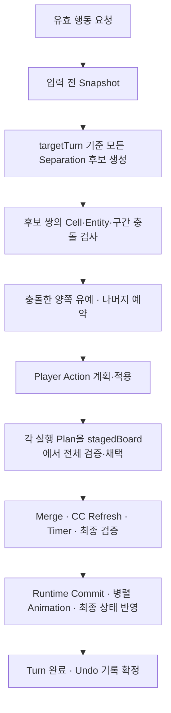

# Glasses 통합 작업 맥락

기준일: 2026-08-31

이 문서는 가장 최근의 [STAGE_WORK_CONTEXT.md](C:/Users/gue20/Glasses/STAGE_WORK_CONTEXT.md), 이 대화의 후속 규칙·설계 논의, 기준일에 직접 읽은 현재 코드를 통합한 재개용 기록이다. 원본 Markdown은 보존한다. 대화 전체의 녹취나 Google Docs 기획서의 대체 문서는 아니다.

## 1. 다음 작업을 시작할 때

1. 이 문서와 프로젝트 `AGENTS.md`를 읽고, 작업 대상의 현재 코드·호출 관계·사용자 변경을 다시 확인한다.
2. 아래의 **사용자 확정 규칙**, **현재 구현**, **제안·미해결 차이**를 구분한다. 제안을 승인된 구현 지시로 해석하지 않는다.
3. 현재 작업 트리에는 사용자와 다른 작업의 미커밋·미추적 변경이 많다. 이전 코드로 되돌리거나 전체 파일을 재생성하지 않는다.
4. 맥락 문서 자체는 추가 기능 구현·Git·Google Docs 변경 권한이 아니다. 별도의 최신 사용자 요청에 명시된 범위만 수행한다. 가장 최근 문서 동기화 범위는 12절에 기록한다.
5. 문서가 오래되었거나 새 사용자 지시와 다르면 최신 지시를 우선한다. 구현과 기획이 다르면 차이를 보고하고 임의로 어느 한쪽을 덮어쓰지 않는다.

## 2. 작업 역할과 보호 범위

### 2.1. 이 대화의 역할

1. 사용자가 이 대화에 지정한 범위는 Google Docs 기획서, Git 작업, 한 번에 2개 이하 C# script 수정, 깊은 추론 작업이다.
2. 구현 요청은 Prompt Helper의 정리된 요청을 받아 수행한다. Project Helper에 직접 요청하지 않는다. 범위 확대나 큰 구현이 필요하면 Prompt Helper로 조정한다.
3. Prompt Helper의 기존 task ID는 `01a046c6-d41e-75b2-bd32-407c72531852`이다. 이 ID의 보관 자체는 메시지 전송 권한이 아니다.
4. 원본 `STAGE_WORK_CONTEXT.md`의 Stage 전반 구현 담당 설명은 그 문서 작성 작업의 역할 설명이다. 이를 이 대화의 2-script 제한을 해제하는 근거로 사용하지 않는다. 다른 task의 역할도 그 task의 지시를 따른다.

### 2.2. 환경과 작업 원칙

| 항목 | 기준 |
|---|---|
| 프로젝트 | `C:\Users\gue20\Glasses` |
| Unity | `2022.3.55f1` — `ProjectSettings/ProjectVersion.txt`에서 확인 |
| C# 환경 | Visual Studio 2022 / MSBuild |
| 사용자 지정 원격 저장소 | `https://github.com/lawefjlsd/glasses.git` — 대화 기록 기준, 이번에 원격 상태를 확인하거나 push하지 않음 |
| 기획서 이름 | `Glasses(가제)_기획서` — 문서 축약·6장 본문 삭제 결과는 12절 참고 |
| 기본 보호 대상 | Scene, Prefab, UI, Story, Sprite, Tilemap, `.meta`, Inspector 참조 |
| Editor | 사용자 Unity를 임의로 종료하거나 열린 Scene을 저장하지 않음 |
| Git | 명시적 요청 없이 commit, push, reset, rollback하지 않음 |

1. `Library`, `Temp`, `Logs`, `obj`를 직접 편집하지 않는다.
2. 분석만 요청받으면 코드를 수정하지 않는다. 스크립트 수정 전 관련 파일과 호출 관계를 읽는다.
3. 실제 수행하지 않은 빌드·테스트·Play Mode 확인을 완료라고 보고하지 않는다.
4. 한국어로 결론을 먼저 보고하고, 여러 항목은 번호 목록을 사용한다. 큰 구조 변경 제안에는 구조도를 포함한다.

## 3. 사용자 확정 게임 규칙

### 3.1. Object와 Zone

| Zone | Object | 핵심 의미 |
|---|---|---|
| Bottom | Ground(G), GroundOneWay(GO), Background(BG), BlockMerged(BM), BlockRevMerged(BRM) | Player가 밟는 표면. Cell당 최대 하나 |
| Top | Block(B), BlockRev(BR), Player(P), Finale(F) | Solid/Trigger의 점유 성격으로 구분 |
| Obstacle | Obstacle(O) | 다른 Stage Object와 겹치지 않는 장애물 |

1. BM/BRM은 고정 Bottom이다. 밀려 이동하는 Block으로 취급하지 않는다.
2. G·GO·BG·BM/BRM을 같은 칸의 Base/Overlay로 중첩시키지 않는다. BG와 BM/BRM 교체는 Merge·Separation 상태 전환으로 처리한다.
3. Object를 추가할 수 있으므로 Zone·MovementCapability·OccupancyType을 이용한 구조를 유지한다.

### 3.2. GO

1. 표기는 `ground_oneway`, 약칭은 `GO_[color]_[W/A/S/D]`이다.
2. Bottom이며 Player 진입에는 기존 색상 조건이 적용된다. 진입 방향 제한은 없다.
3. 나갈 때는 지정된 한 방향만 허용한다. Player 이동과 Block Push 모두 적용된다.
4. Separation Chain도 GO 이탈 조건을 따라야 한다. 경로의 Block 하나라도 지정 방향으로 나갈 수 없으면 해당 Separation은 실행할 수 없다.

### 3.3. Merge와 Current Color

1. B와 BG가 Merge되어 BM이 만들어지고, BR과 BG는 BRM이 된다.
2. 현재 코드에서 BM/BRM 색상은 원본 Block의 `colorName`을 사용한다. BG의 `acceptedColorName`은 Merge 허용 판정에 사용한다.
3. Add/Remove 이벤트는 해당 색상 성분에 대해 후속 이벤트가 앞선 결과를 덮어쓰는 순서를 가진다. 같은 batch에서는 Add가 먼저, Remove가 나중이다.
4. Yellow BR의 Remove는 Red와 Green 성분을 제거한다. 이를 별도의 예외로 두지 않는다.
5. 현재 B/BR의 차이는 `Block`의 `MergeColorEffect.Add/Remove`로 표현한다. 별도 옛 BlockRev 실행 경로를 복구하지 않는다.
6. Separation 뒤 발생하는 Merge도 기존 Merge 단계에서 처리하고, CC는 최종 유효 Merge 상태를 바탕으로 갱신한다.

### 3.4. Turn과 Player

1. 확정 순서는 `Input → Snapshot → Separation Schedule → Player Action → Separation → Merge → Current Color Refresh → Commit → Animation → Turn Complete`이다.
2. Snapshot은 Player 위치가 바뀌기 전의 상태다. Schedule은 그 Snapshot과 `targetTurn = snapshot.turnId + 1`로 계산한다.
3. `remainingTurns == 0`은 분리 대상 조건이다. 생성된 같은 Turn에 즉시 Separation하지 않는다. 정상 만료 메타데이터에서는 remaining 1인 입력 전 상태도 targetTurn이 dueTurn이면 이번 Turn의 분리 대상이다.
4. 유효한 Player 입력이면 Player가 이동하고 Turn이 진행한다. 이동 선택지가 없다는 이유만으로 별도 Stuck 상태를 만들거나 자동 Undo/Restart를 하지 않는다.
5. Player는 Separation보다 먼저 행동한다. Separation 경로의 현재 Player 점유만으로 분리를 Deferred하지 않는다.
6. Separation Chain은 Player Cell에서 끝난다. Player를 밀지 않으며 Player 너머 Block도 그 Separation Chain에 포함하지 않는다. Player 자신의 별도 Push는 구분한다.
7. Player 이탈용 `requiresActorVacate`, `actorVacateCell`, `isPlayerException` 등의 저장 필드나 Bool에 의존하지 않는다. 기존 enum, Entity, `actorMovement`, `chainMovements`, 원본 복원 정보를 사용한다.
8. 사용자 요구의 '유효 입력'과 현재 코드의 이동 제한 처리 사이에는 7절의 미해결 의미 차이가 남아 있다. 이 문서를 근거로 벽 통과·제자리 Turn·강제 이동을 추가하지 않는다.

### 3.5. 동시 Separation에 대한 사용자 제약

1. 같은 Turn에 due인 두 BM의 경로 충돌을 생성 순서, BM/BRM 종류, Entity 나열 순서로 승패 처리하지 않는다.
2. 플레이어가 공간 관계로 예측할 수 있어야 하며, 새 우선 속성이나 숨은 오브젝트·계획 데이터를 추가하지 않는다.
3. 한 Plan의 Chain만 밀고 BM은 남기는 부분 실행을 허용하지 않는다.
4. 구체적으로 '어디까지 경로 겹침으로 볼 것인가'는 현재 구현과 이 대화의 마지막 제안이 다르다. 6~7절을 함께 읽어야 한다.

## 4. 현재 Stage 구조

| 구성 요소 | 현재 역할 / 핵심 진입점 |
|---|---|
| `Player` | 방향·Undo 입력 전달 |
| `StageTurnController` | `ExecuteTurn()`, `ExecuteUndo()`, 초기 Merge 한 번 실행, Runtime 연결 |
| `StageBoard` | `Capture()`, `CreateSnapshot()`, `CreateWorkingCopy()` 및 Entity ID 생성 |
| `StageBoardWorkingCopy` | `QueryCell()`, 예약, `TryApply()`, `ValidateBoard()` |
| `BlockManager` | 일반 Push와 Separation Push의 별도 진입점, 공통 Chain 계산 |
| `SeparationManager` | 공통 Snapshot 후보 생성, 후보 쌍 경로 충돌 판정 |
| `PlayerActionResolver` | 기존 지형·색상·예약·Push 조건으로 행동 계획 계산 |
| `StageTurnResolver` | Player Action 적용, Plan 단위 Separation, Merge, CC, Timer, 결과 검증 |
| `StageRuntimeCommitter` | 논리 결과를 Runtime Object·Component에 반영하고 Animation 실행 |
| `MovementHelper` | 이동 애니메이션 |
| `UndoManager` | 전체 BoardSnapshot 보관·복원 |

주요 기존 enum은 `StageEntityKind`, `StageZone`, `MovementCapability`, `OccupancyType`, `MovementIntent`, `PlayerActionOutcome`, `PlayerActionFailureReason`이다. `MovementIntent.SeparationRestore`를 모든 Chain 이동의 의미로 임의 확장하지 않는다. 밀리는 Chain Block의 실제 이동은 Push다.

## 5. 후속 변경 중 현재 코드에서 확인한 사항

아래는 기준일 정적 확인 결과다. 이번 문서 작업에서 해당 코드를 수정하거나 재실행한 것은 아니다.

| 변경 | 현재 구현 근거 / 주의점 |
|---|---|
| Origin Entity ID 통일 | `StageBoard.CreateMergedState()`가 원본 `Block`/`BlockBackground` Component를 조회하고 공통 `CreateEntityId()`를 사용 |
| 만료 Turn 기준 | Controller가 `snapshot.turnId + 1`을 `CreateSchedule()`에 전달 |
| Commit 역동기화 | `StageRuntimeCommitter.ApplyCommittedComponentState()`가 `BlockMerged.ApplyCommittedState()`를 호출 |
| stale reference 방지 | `TryApply()`가 Entity Dictionary를 Clone으로 교체하므로, Resolver가 적용 후 `TryGetCurrentSeparationEntities()`로 다시 조회 |
| Plan 전체 원자 적용 | `ApplySeparations(ref board, ...)`가 별도 `stagedBoard`에서 Chain 이동·BM 해제·원본 복원을 검증한 뒤 Board와 AnimationBatch에 반영 |
| Player Chain 종료 | `TryCreateSeparationPushPlanPure()`가 `IsSeparationPlayer()` 조건을 사용. 일반 Push 진입점은 이 종료 조건을 사용하지 않음 |
| Player 판정 | `Player + Top + SelfMovable + Solid`. 현재 분류 메서드는 `actorEntityId` 인자를 받지 않으며, 단일 Player 전제와 구분해야 함 |
| Vacate 전용 상태 제거 | `SeparationPlan`의 두 Vacate 필드와 `CanVacateReservedSource()` 의존이 제거됨 |
| 출발 Cell 예약 | PlayerActionResolver는 Cell 예약을 새 진입 제한으로 취급. 출발 Cell 이탈은 막지 않지만 Entity 예약·목적지·GO 등은 검사 |
| Player 실행 후 검증 | Resolver가 `actorMovement.entityId/to`와 현재 actor Cell을 검사. Player가 복원/Chain 도착 Cell에 남으면 정상 Deferred가 아닌 내부 계획 오류 |
| Undo 호출 순서 | `TryBeginUndoSnapshot()` 성공 뒤 `SetUndoRunning(true)` 호출 |
| 초기 Merge | `InitialMergeCheckGuard`, `RunInitialMergeCheckOnce()`, `ResolveInitialMerges()`로 Controller 생명주기당 초기 검사 한 번. Turn 소비와 별도 |

### 5.1. 다시 같은 버그를 만들지 않기 위한 원인 기록

1. **Origin 조회 실패:** Snapshot 키는 Component Instance ID였지만 원본 ID는 GameObject Instance ID여서, 정상 참조인데도 `Separation origin entities are missing`이 발생했다. 문자열 prefix만 맞는 것으로 ID 일관성을 판단하지 않는다.
2. **Chain만 밀리고 다음 Turn 분리:** `TryApply()` 이전의 `merged/block/background` 참조를 이후에도 수정해, 새 Dictionary에는 비활성화·복원이 반영되지 않았다. 현재 Dictionary 재조회와 Plan 전체 staging을 유지한다.
3. **Player 때문에 한 Turn 유예:** 원본 복원 Cell에는 예외가 있었지만 Chain 끝은 일반 Push의 non-pushable 실패로 처리됐다. 현재는 별도 Vacate 상태 없이 동일한 enum 분류로 탐색을 끝낸다.
4. **로그 시점 혼동:** Snapshot의 remaining은 입력 전 값이다. Resolver 이후 값과 같은 시점으로 비교하지 않는다. `[SeparationDebug]`의 Snapshot, Schedule, Resolver, Commit 단계를 구분한다.
5. 런타임 `merged:<instanceId>` 변화만으로 Origin ID 불일치나 논리 객체 재생성을 단정하지 않는다. 어떤 Component를 캡처했는지와 생성·복원 경로를 별도 확인한다.

## 6. 현재 구현된 동시 Separation 충돌 모델

근거: [SeparationManager.cs](C:/Users/gue20/Glasses/Assets/Scripts/SeparationManager.cs)의 `CreateSchedule()`, `DeferConflictingPaths()`, `PathsConflict()`, `SegmentsIntersect()`.

1. 모든 후보를 예약·이동을 적용하지 않은 공통 Snapshot에서 생성한다.
2. Entity ID 정렬은 출력 순서 고정용이다. 앞 Plan이 예약을 선점하는 의미는 없다.
3. 이미 지형 등 때문에 Deferred된 후보는 후보 쌍 비교에서 제외한다.
4. 실행 가능한 후보의 경로에는 Chain 이동과 원본 Block의 `merged.cell → originBlockCell` 복원 구간이 포함된다.
5. `reservedEntities` 공유, `reservedCells` 공유, 또는 이동 구간 교차가 있으면 두 Plan을 충돌 목록에 넣는다. 선분 끝점 공유도 교차에 포함된다.
6. 모든 후보 쌍을 검사한 뒤 충돌한 양쪽을 함께 Deferred로 바꾸고 예약을 비운다. A-B 충돌 뒤 B-C 검사를 생략하지 않는다. 따라서 A-B와 B-C가 모두 충돌하면 현재 구현은 A/B/C를 모두 유예한다.
7. 충돌하지 않은 독립 Plan만 예약·실행한다. 실행 직전에 Player Action 이후 Board를 검증하지만 같은 Turn의 Chain 경로를 다시 계산하지 않는다.
8. Runtime 적용 전에 각 Plan 전체를 staging한다. 현재 구현은 공유 이동을 합친 하나의 전체 Separation Batch를 실행하는 구조가 아니다.
9. 현재 `deferReason`은 `Separation paths overlap or intersect in the same Snapshot.`이다.

## 7. 대화의 마지막 제안과 현재 구현의 차이

이 절은 **미해결 차이의 기록**이다. 자동으로 수정할 항목이나 사용자 확정 규칙으로 취급하지 않는다.

### 7.1. 최종 점유 중심 제안과 경로 겹침 중심 구현

마지막 답변의 추천 문장은 다음과 같았다.

> 두 BM의 분리·Chain 이동·원본 복원을 동시에 놓았을 때 공간 점유가 성립하면 함께 실행하고, 서로 같은 공간이나 Block에 모순된 이동을 요구하면 두 분리 모두 실행하지 않는다.

| 사례 | 마지막 답변의 설계 제안 | 기준일 현재 코드 |
|---|---|---|
| 서로 다른 Block이 같은 목적지에 도착 | 양쪽 유지 | 양쪽 Deferred |
| 같은 Block에 서로 다른 이동 요구 | 양쪽 유지 | 공유 Entity 등으로 양쪽 Deferred |
| 동일한 Block의 동일 이동 공유 | 한 번의 이동으로 합칠 가능성을 허용하되 최종 복원 충돌도 검사 | 공유 Entity만으로 양쪽 Deferred |
| 공유 Cell이 있어도 최종 Top/Bottom 공존은 합법 | 다른 충돌이 없으면 허용 가능하다고 제안 | 예약 Cell 공유 또는 복원 이동 구간 공유이면 양쪽 Deferred |
| 무관한 Bottom/Trigger | 그 존재만으로 분리를 막지 않음 | 관련 테스트가 존재. 다른 due BM의 원본 복원 경로와 겹치는 경우와는 구분 |
| 한쪽이 자체 장애물로 막힘 | 다른 쪽이 유지 상태와 양립하면 실행 | 자체 Deferred 후보는 쌍 충돌에서 제외 |

앞서 제안한 '시간·생성 순서로 승자를 고르는 모델'은 사용자가 원하지 않는 방향이므로 재도입하지 않는다. 반대로 현재 코드가 존재한다는 이유만으로 위 허용 범위의 차이에 대한 사용자 합의까지 있었다고 단정하지 않는다.

현재 테스트 `RestorationStartIntersectingChainIsNotIgnoredAsBottomOnly()`는 복원 시작점을 단순 Bottom 공유로 무시하지 않는 구현을 명시한다. 마지막 답변의 Top/Bottom 공유 허용 예시와 비교할 때 반드시 함께 확인한다.

### 7.2. 대표 배치

`MA>`, `<MB`, `MB^`는 기존 분리 방향을 가진 BM, `x/y`는 현재 Block, `a/b`는 원본 복원 Block, `.`은 사용 가능한 Bottom 위 빈 Top을 뜻한다. 모든 예시는 Separation 단계 기준이며 이후 Merge는 별도다.

1. 같은 빈칸으로 마주 밀기: 양쪽 실행 불가.

```text
[MA>]  [ x ]  [ . ]  [ y ]  [<MB]
                X
```

2. 다른 빈칸으로 이동: 양쪽 실행 가능.

```text
이전: [MA>]  [ x ]  [ . ]  [ . ]  [ y ]  [<MB]
이후: [BG_A] [ a ]  [ x ]  [ y ]  [ b ]  [BG_B]
```

3. 같은 원본 복원 칸: 양쪽 실행 불가.

```text
[MA>]  [ . ]  [<MB]
         X
```

4. 다음 배치는 최종 점유만 보면 `BG_B+x`가 가능하다는 제안이 있었지만, **현재 구현은 B의 복원 시작점·예약 Cell과 A의 Chain 도착이 겹치므로 양쪽 Deferred**다. 실행 가능 확정 예시로 재사용하지 않는다.

```text
              [ . ]
[MA>]  [ x ]  [MB^]
```

### 7.3. 유효 입력의 의미

1. 사용자 의도는 유효 입력에서 Player 이동과 Turn 진행을 보장하고, Player의 현재 경로 점유 때문에 Separation을 유예하지 않는 것이다.
2. 현재 `PlayerActionResolver`는 Obstacle, GO 방향, 색상, Bottom 부재, 목적지 예약 등에 `Blocked`를 반환하고, Controller는 `Move`가 아니면 Resolver/Commit 전에 종료한다. 관련 테스트도 남아 있다.
3. '방향값이 유효한 WASD'와 '게임 규칙상 실행 가능한 행동'이 같은 뜻인지에 대한 완전한 합의는 이 대화만으로 확인되지 않는다.
4. 이동 불가능 방향의 새 상태·강제 이동·벽 통과·제자리 Turn을 문서 정리만으로 승인된 것으로 보지 않는다. 다음 구현 요청에서 이 경계를 먼저 확인한다.

### 7.4. 유예 Timer의 실제 동작

1. 현재 `UpdateRemainingTurns()`는 Deferred된 BM/BRM의 값을 그대로 유지한다.
2. 따라서 입력 전 값이 0이면 0으로 남지만, targetTurn 기준 due인 입력 전 값이 1인 Plan은 유예되면 1로 남을 수 있다. '유예되면 항상 화면상 0'이라고 기록하지 않는다.
3. 생성/만료 Turn 정보로 다음 Schedule에서 다시 due 판정을 받는다. 유예 때문에 0을 1로 직접 되돌리는 이전 정책과 현재의 값 유지 정책을 구분한다.
4. 절대 Turn 메타데이터가 없는 legacy 분기에는 `Math.Max(1, remainingTurns - 1)`이 남아 있다. 정상 메타데이터 경로와 섞어 일반화하지 않는다.

### 7.5. 화면 예측성과 실제 실행 순서

1. 현재 분리 방향은 `originBlockCell`과 BM Cell의 관계를 사용한다. 이 기존 정보가 화면에서 드러나지 않으면 '현재 보드만 보고 예측'한다는 UX 목표를 완전히 만족하는지는 확인이 필요하다. 새 방향·우선 속성을 만든다는 뜻은 아니다.
2. 논리 Turn 순서와 Runtime 연출 순서를 구분한다. 현재 Committer는 이동 Animation들을 시작하고 완료를 기다린 뒤 `ApplyFinalState()`로 최종 Transform·활성·Component 상태를 반영한다.
3. `ValidateBoard()`는 Solid Top 중복을 GameOver 후보로 표시할 수 있다. `isValid`만으로 '분리 사이 점유 충돌이 없음'을 판정하지 않는다.

## 8. 검증 기록과 남은 확인사항

### 8.1. 원본 Markdown에 기록된 직전 검증

다음은 `STAGE_WORK_CONTEXT.md`의 보고를 옮긴 것이다. 이번 통합 문서 작성에서 빌드·테스트 결과 파일을 재검증하거나 실행하지 않았다.

| 검사 | 원본 문서의 기록 |
|---|---|
| Runtime / EditMode MSBuild | 각각 경고 0·오류 0 |
| StageTurnResolverTests | 63/63 통과 |
| GroundOneWayTests | 6/6 통과 |
| StageBoardTests | 57/58 통과 |
| 환경 | 별도 임시 Unity 프로젝트 |
| 실제 Stage Play Mode | 미실행 |

### 8.2. 미해결·미검증 항목

1. `PlayerActionResolver_RejectsObstacleAndMissingBottom`의 입력이 Ground+Obstacle 중첩인데 기대값은 `Obstacle`인 테스트 불일치가 원본 문서에 기록되어 있다. 입력 구성 또는 기대값 의미를 검토해야 하며 게임 규칙부터 바꾸지 않는다.
2. 실제 사용자 맵의 입력, 분리 애니메이션, 활성 전환, CC·Timer 표시, Undo 복원은 Play Mode 확인이 필요하다.
3. 일부 Scene과 `ProjectSettings/TagManager.asset`의 공백 오류가 원본 문서에 기록되어 있다. 이번 문서 작업에서 이를 수정하거나 전체 검사를 다시 실행하지 않는다.
4. 7절의 경로 충돌 범위, 유효 입력 의미, Deferred Timer 표시 차이는 추가 구현 전 확인 대상이다.
5. 코드에 테스트가 있다는 사실과 그 테스트가 현재 환경에서 통과했다는 사실을 구분한다.

### 8.3. 현재 존재하는 주요 회귀 테스트

1. Origin Component ID와 Snapshot Key 일치, targetTurn 만료 경계, 같은 Turn 생성 BM 분리 금지.
2. Chain Push와 원본 복원의 같은 Turn 처리, BRM 분리, stale reference 재발 방지.
3. Player에서 Chain 종료, Player 너머 미포함, 일반 Push 구분, GO·목적지 검사 유지.
4. 같은 복원 Cell, 교차 Chain, 마주 보는 Chain, 복원 시작점 침범에 대한 양쪽 유예.
5. 독립 경로 실행, 후보 Dictionary·생성·실행 순서 변경에도 결과 일치, 모든 후보 쌍 검사.
6. Player Action이 충돌 Schedule 이후 경로를 다시 계산하지 않음, Plan 중간 상태를 공개하지 않음.
7. 초기 Merge 한 번 실행과 Turn 비소비, Undo 전체 상태 복원.

## 9. 다음 요청에 필요한 재현 정보

1. Scene·Object 이름과 입력 순서, 기대 결과와 실제 결과.
2. Player·BM·origin·Chain Block의 Cell, Current Color, remainingTurns, Snapshot/target/due Turn.
3. `[SeparationDebug]` 로그 원문. 입력 전 Snapshot과 Resolver/Commit 후 결과를 구분한다.
4. Editor Play Mode·미저장 Scene 여부와 수정 허용 범위.
5. 분석만인지 구현까지인지, Git 또는 Docs 갱신까지 포함하는지.

## 10. 문서 관리와 재참조

1. 이 통합본을 현재 재개용 색인으로 사용하고 원본 `STAGE_WORK_CONTEXT.md`는 이전 검증 보고의 출처로 보존한다.
2. 변경이 생기면 확정 규칙, 실제 구현, 미해결 차이, 검증 기록을 각각 갱신한다. 제안을 구현 완료로 바꾸려면 현재 코드와 실제 검증 근거가 필요하다.
3. `AGENTS.md`에 이 문서를 읽는 경로를 기록한다. 이것은 프로젝트 파일 기반의 지속 기록이며, 모든 새 대화에 내용을 자동으로 기억한다고 보장하는 표현을 사용하지 않는다.
4. 최초 통합본 작성에서는 Markdown과 재참조 지침만 작성했다. 후속 문서·Git 작업은 별도 사용자 승인에 따라 12절에 기록하며, Unity 변경 권한으로 확대하지 않는다.

## 11. 기준일 현재 흐름



## 12. Google Docs·문서 Git 동기화 기록

기록일: 2026-08-31. 사용자가 Google Docs 편집과 문서 파일만의 로컬 Git 반영을 요청했으며, Unity 상태 변경과 push를 금지했다.

1. 대상은 [Glasses(가제)_기획서](https://docs.google.com/document/d/1pXi7zkNsTA2auUYzuO4blo_taaf1_9UdjsVqIBEwrpc/edit)이며 문서버전은 `v1.5`로 갱신했다.
2. 기존 단일 탭과 1~9장 구조를 유지했다. 전체 제목·소제목 55개의 문구·순서·서식과 UI 이미지 1개를 보존했다.
3. Google Docs의 **6. 챕터 / 스테이지 기획**은 장 제목·챕터 소제목·개별 Stage 소제목 총 19개만 남겼다. 본문, 맵 표 13개, 페이지 나눔은 사용자 지시로 삭제했다. 이후 기획서 동기화에서 본문을 자동 복구하지 않는다. 이 로컬 맥락 문서의 6절을 비우라는 요청은 아니다.
4. 1~5장과 7~9장의 중복 설명·나열·프롤로그를 축약하고, 구형 턴 순서·항상 1턴 유예·BlockRev 별도 실행 경로 설명을 현재 코드에 맞췄다. 텍스트는 표 내부 포함 11,731자에서 8,540자로 약 27% 줄었다.
5. 현재 구현과 미해결 사항을 구분했다. 동시 분리의 경로 충돌/최종 점유 제안 차이, 유효 입력 정의, 유예 Timer 표시, Board 테스트 기대값 불일치, 실제 Stage·UI Play Mode 미검증을 남겼다. 기존 검증 기록은 새 실행 결과로 표시하지 않았다.
6. UI는 Hierarchy 기반 Controller·SceneUIRouter·진행 서비스 및 현재 Stage 버튼 진입을 기록했다. WASD 입구 진입 기획, 컷씬/돌아보기/저장 규칙과 실제 연결 검증은 구분한다. 문서 수정은 Unity UI·Story·Scene을 수정한 것이 아니다.
7. Google Docs 재조회로 제목·소제목·서식·탭·이미지 보존과 6장 본문 부재를 확인했다. 파일 기반 사전 읽기 도구가 Windows 절대 경로를 지원하지 않아 직접 연결 도구로 구조·서식을 확인했다. PDF 내보내기는 성공했으나 반환된 원격 파일을 로컬에서 열 수 없어 렌더링 시각 검사는 미완료다.
8. Git 반영 대상은 루트의 `AGENTS.md`, `GLASSES_CONTEXT.md`, `STAGE_WORK_CONTEXT.md`뿐이다. 원본 Stage 작업 요약은 내용 변경 없이 기록에 포함한다. Unity 파일은 스테이징·커밋 대상에서 제외하며 `reset`, `checkout`, `clean`, `push`는 사용하지 않는다.
9. 이번에는 Unity 실행·빌드·테스트·에셋 가져오기를 하지 않는다. Stage 코드의 현재 동작은 읽기 전용으로 대조했으며, 보호 디렉터리의 작업 전후 내용 해시와 Git staged 파일 목록으로 문서 외 변경 여부를 확인한다.
