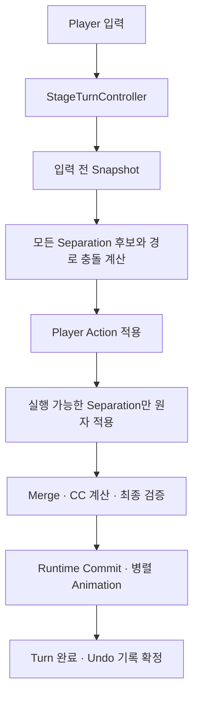

# Glasses 작업 맥락 및 후속 작업 안내

작성 기준: 2026-08-31

이 문서는 다음 작업을 이어가기 위한 요약이다. 완료된 개별 버그 수정 내역은 제외하고, 역할·사전정보·현재 설계·남은 확인사항을 정리한다. 이전 수행 작업은 맥락에 필요한 몇 가지 사례만 포함한다.

## 1. 내가 맡고 있는 일

1. Unity 프로젝트의 Stage 핵심 로직을 읽고, 사용자가 확정한 게임 규칙을 C# 코드와 테스트로 구현한다.
2. 이동·Push·Separation·Merge·Current Color·Undo가 하나의 턴 흐름에서 일관되게 동작하는지 확인한다.
3. 문제가 발생하면 호출 관계, 논리 Board, Runtime 반영을 구분해 원인을 조사한다.
4. 수정 후 컴파일·EditMode 테스트·정적 검사를 수행하고, 실제로 확인한 결과와 미검증 사항을 구분해 보고한다.

## 2. 작업에 필요한 기본 정보

| 항목 | 현재 기준 |
|---|---|
| 프로젝트 | `C:\Users\gue20\Glasses` |
| Unity | `2022.3.55f1` |
| C# 개발·컴파일 | Visual Studio 2022 / MSBuild |
| 작업 지침 | 프로젝트 `AGENTS.md`와 전역 `C:\Users\gue20\.codex\AGENTS.md` |
| 사용자 변경 | Scene·Sprite·스크립트 등에 미커밋 변경이 섞여 있음. 작업 전 현재 파일과 diff를 다시 확인해야 함 |
| 보호 범위 | 최근 Stage 로직 작업에서는 Scene·Prefab·UI·Story·Sprite·Tilemap·`.meta`를 수정하지 않음 |
| Editor | 실행 중인 사용자 Unity를 임의로 종료하거나 열린 Scene을 저장하지 않음 |
| Git | 명시적인 요청 없이 커밋·push·롤백하지 않음 |

`Library`, `Temp`, `Logs`, `obj`는 직접 편집하지 않는다. 기존 Inspector 연결과 serialized field 이름을 보존하고, 이해되지 않은 기획은 임의로 구현하지 않는다.

## 3. 다음 작업에서 알아야 할 현재 설계

### 3.1. 주요 역할

| 구성 요소 | 역할 |
|---|---|
| `Player` | 입력 전달 |
| `StageTurnController` | 턴 순서와 Commit·Animation·Undo 연결 지휘 |
| `StageBoard` | Snapshot, Working Copy, 논리 점유 상태와 검증 |
| `BlockManager` / `SeparationManager` | Push 계획 / Separation 후보·경로 충돌 계산 |
| `PlayerActionResolver` / `StageTurnResolver` | Player 행동 / 턴 전체 결과 계산 |
| `StageRuntimeCommitter` / `MovementHelper` | 확정 결과를 Runtime에 반영 / 이동 애니메이션 |
| `UndoManager` | 전체 BoardSnapshot 기반 복원 기록 |

이름에 Manager가 있더라도 역할을 추정하지 말고 현재 호출부를 확인한다. 과거 Coroutine 기반 이동 경로를 다시 연결하지 않는다.

### 3.2. 유지해야 할 규칙

1. 논리 계산은 Snapshot과 Working Copy를 사용한다. 애니메이션 중 Transform 상태를 게임 판정 기준으로 삼지 않는다.
2. Bottom은 Cell당 최대 하나다. G·GO·BG·BM·BRM을 Base/Overlay로 겹치는 모델로 되돌리지 않는다. BM/BRM은 이동하지 않는다.
3. Separation 후보는 입력 전 Snapshot과 `targetTurn = snapshot.turnId + 1`을 기준으로 계산한다. Player Action이 먼저 적용되어도 같은 턴의 경로를 다시 계산하지 않는다.
4. Separation Chain은 Player Cell에서 끝난다. Player를 밀거나 Player 너머의 Block을 해당 Chain에 넣지 않는다. 일반 Player Push와 구분한다.
5. 같은 Snapshot의 Separation 경로가 Cell·Entity·이동 구간을 공유하면 충돌한 양쪽 Plan을 유예한다. 생성 순서로 승자를 정하지 않는다. 독립된 경로는 실행한다.
6. 하나의 Separation Plan은 Chain 이동, BM/BRM 비활성화, 원본 B/BG 복원을 함께 반영한다. 유예된 BM/BRM의 remainingTurns를 임의로 1로 되돌리지 않는다.
7. Merge와 CC 계산에서는 같은 batch의 Add 효과를 먼저, Remove 효과를 나중에 적용한다. Undo에서도 원본 참조·효과·순서·타이머가 유지되어야 한다.
8. 초기 Merge 검사는 Stage 초기화 시 한 번 수행한다. 일반 턴 처리에 중복 초기화 경로를 추가하지 않는다.

## 4. 남아 있는 확인사항

1. **기존 EditMode 테스트 기대값 불일치 1건**

   1. 대상: `Assets/Tests/EditMode/StageBoardTests.cs`의 `PlayerActionResolver_RejectsObstacleAndMissingBottom`.
   2. 테스트가 Ground+Obstacle 중첩을 만들고 `Obstacle`을 기대하지만, 현재 Board 검증은 `InvalidBoard`를 반환한다.
   3. 테스트 입력을 유효한 장애물 Cell로 바꿀지, InvalidBoard 검증 사례로 분리할지 확인이 필요하다. 테스트를 통과시키기 위해 게임 규칙부터 바꾸면 안 된다.

2. **원본 Stage의 Play Mode 검증**

   1. 실제 맵에서 입력, 분리 애니메이션, 활성 상태 전환, 화면상 CC·Timer, Undo 복원이 일치하는지는 별도 확인이 필요하다.
   2. 임시 프로젝트의 EditMode 통과를 실제 맵 Play Mode 통과로 간주하지 않는다.

3. **기존 작업 트리의 공백 오류**

   1. 일부 Scene과 `ProjectSettings/TagManager.asset` 때문에 전체 `git diff --check`가 실패한다.
   2. 사용자 변경과 보호 범위에 포함되므로 임의로 정리하지 않는다.

현재 승인된 후속 기능 구현은 없다. 위 항목은 남은 검증·정리 후보이지 자동 수정 지시가 아니다.

## 5. 새로운 문제를 맡길 때 필요한 정보

1. 문제가 발생하는 Scene 이름과 관련 Object/Prefab 이름.
2. 재현 입력 순서, 기대 결과, 실제 결과.
3. 관련 Cell 좌표, Current Color, remainingTurns, Snapshot Turn과 dueTurn.
4. 가능하면 Console 로그 원문, Hierarchy/Inspector 화면 또는 짧은 재현 영상.
5. 수정 허용 범위와 현재 Editor의 Play Mode·미저장 Scene 여부. 기존 보호 범위와 다른 작업이 필요하면 먼저 명시한다.

## 6. 내가 수행했던 일의 예시

1. Stage 실행의 책임을 논리 Board·계획 계산·턴 제어·Runtime 반영으로 나누고 호출 관계를 정리했다.
2. 사용자가 제시한 배치와 입력을 FromSnapshot 기반 회귀 테스트로 옮겨 검증했다.
3. 원본 Editor를 건드리지 않는 임시 프로젝트에서 Unity EditMode 테스트를 실행하고, 보호 파일의 변경 여부를 해시로 비교했다.

완료된 개별 수정 사항을 다시 할 일 목록으로 나열하지 않는다.

## 7. 마지막 검증 기록

아래는 직전 코드 수정의 검증 결과이며, 이 문서 작성 중 빌드·테스트를 다시 실행한 결과는 아니다.

| 검사 | 결과 |
|---|---|
| Runtime / EditMode MSBuild | 각각 경고 0·오류 0 |
| StageTurnResolverTests | 63/63 통과 |
| GroundOneWayTests | 6/6 통과 |
| StageBoardTests | 57/58 통과 — 남은 실패는 4절 참고 |
| 실행 환경 | 별도 임시 Unity 프로젝트 |
| 실제 Stage Play Mode | 미실행 |

## 8. 현재 턴 흐름

